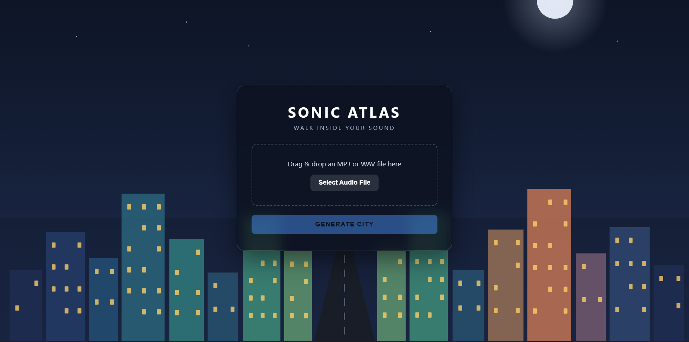
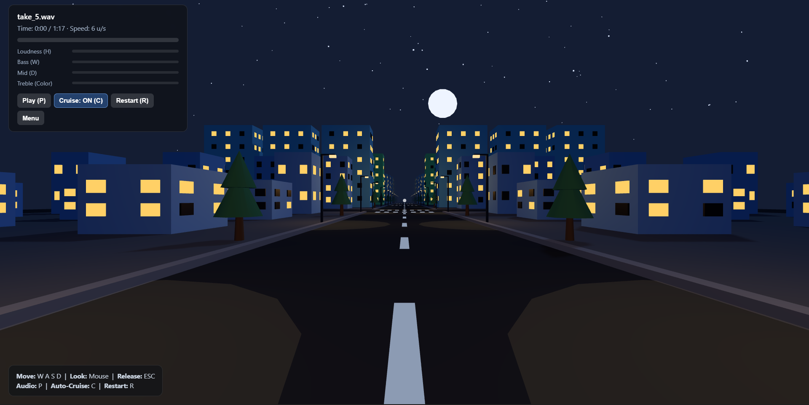
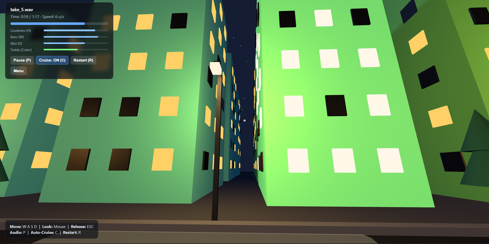

# Sonic Atlas
## Inspiration
Most music visualisers output boring flat 2D bars. We wanted to turn a song into a walkable city, with building characteristics to be directly affected by the song.

## What it does
Upload an MP3 or WAV file and get a uniquely generated low-poly 3D city. Sonic Atlas analyses the loudness, bass and treble of the song to determine height, width and colour. The city can be explored freely in first-person, with playback to allow going back and forth through the song and the automatic cruise feature that will take you through the rhythm.

## How we built it
We used React, Vite, Three.js and Web Audio API. We implemented a fast in-memory Radix-2 FFT to extract audio features quickly. We then mapped them onto a city block layout, and hooked a real-time AnalyserNode to drive beat-reactive street lamps and active building highlights.

## Prerequisites
Before running the project, make sure you have installed:
- Node.js
- npm (included with Node.js)
- git (for repository cloning)

## Installation
Follow these steps to install and run the project locally.
1. **Clone the repository**
   ```bash
   git clone <repository-url>
   ```
2. **Navigate to the project directory**
   ```bash
   cd DurHackXI
   ```
3. **Install dependencies**
   ```bash
   npm install
   ```
4. **Start the application**
   ```bash
   npm run dev
   ```

## Screenshots




## Challenges we ran into
### Fast full-track analysis
AnalyserNode only runs in real time, so we wrote a custom Radix-2 FFT with Hann windowing to scan entire tracks in under a second.
### Staying synced across intersections
Locking the automatic cruise feature to audio.currentTime so walking never drifts from the music.
### Consistent performance at scale
Using InstancedMesh for thousands of height-scaled windows, cone trees and lamps. PointLights following the player to stay smooth without hitting WebGL limits.

## Accomplishments that we're proud of
No backend, the MP3/WAV processing happens directly in the browser. Playback system to allow the user to go back and forth, if needed. Cohesive atmosphere with beat-pulsing streetlights and living apartment windows, adding more charm and life to the city.

## What we learned
Bridging audio with real-time 3D graphics directly in the browser. Extracting RMS loudness, bass and treble from tracks in milliseconds. Utilising dynamic light pooling to ensure smooth performance.

## What's next for Sonic Atlas
Selectable visual themes, custom building shapes, different terrain landscapes.
